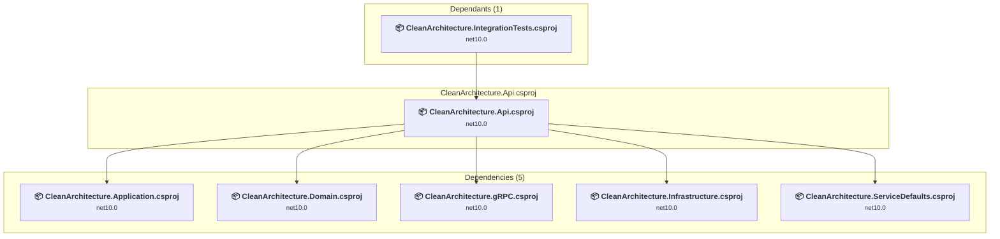

# CleanArchitecture.Api\CleanArchitecture.Api.csproj

[← Back to the assessment index](../../assessment.md)

## Project Info

- **Current Target Framework:** net10.0
- **Proposed Target Framework:** net11.0
- **SDK-style**: True
- **Project Kind:** AspNetCore
- **Dependencies**: 5
- **Dependants**: 1
- **Number of Files**: 16
- **Number of Files with Incidents**: 3
- **Lines of Code**: 745
- **Estimated LOC to modify**: 5+ (at least 0,7% of the project)

## Related Projects

**Depends on (5)** — projects this one references:

- [C:\Users\pierr\projets\CleanArchitecture-upgrade-agent\CleanArchitecture.Application\CleanArchitecture.Application.csproj](../projects/CleanArchitecture.Application.md)
- [C:\Users\pierr\projets\CleanArchitecture-upgrade-agent\CleanArchitecture.Domain\CleanArchitecture.Domain.csproj](../projects/CleanArchitecture.Domain.md)
- [C:\Users\pierr\projets\CleanArchitecture-upgrade-agent\CleanArchitecture.gRPC\CleanArchitecture.gRPC.csproj](../projects/CleanArchitecture.gRPC.md)
- [C:\Users\pierr\projets\CleanArchitecture-upgrade-agent\CleanArchitecture.Infrastructure\CleanArchitecture.Infrastructure.csproj](../projects/CleanArchitecture.Infrastructure.md)
- [C:\Users\pierr\projets\CleanArchitecture-upgrade-agent\CleanArchitecture.ServiceDefaults\CleanArchitecture.ServiceDefaults.csproj](../projects/CleanArchitecture.ServiceDefaults.md)

**Depended on by (1)** — projects that reference this one:

- [C:\Users\pierr\projets\CleanArchitecture-upgrade-agent\CleanArchitecture.IntegrationTests\CleanArchitecture.IntegrationTests.csproj](../projects/CleanArchitecture.IntegrationTests.md)

## Dependency Graph

Legend:
📦 SDK-style project
⚙️ Classic project

## API Compatibility

| Category | Count | Impact |
| :--- | :---: | :--- |
| 🔴 Binary Incompatible | 0 | High - Require code changes |
| 🟡 Source Incompatible | 0 | Medium - Needs re-compilation and potential conflicting API error fixing |
| 🔵 Behavioral change | 5 | Low - Behavioral changes that may require testing at runtime |
| ✅ Compatible | 553 |  |
| ***Total APIs Analyzed*** | ***558*** |  |

## NuGet Package Issues

| Package | Current Version | Suggested Version | Severity | Issue |
| :--- | :---: | :---: | :---: | :--- |
| Microsoft.AspNetCore.Authentication.JwtBearer | 11.0.0-rc.1.26425.128 | 11.0.0-rc.3.26522.148 | 🟡 Potential | La mise à niveau du package NuGet est recommandée |
| Microsoft.AspNetCore.OpenApi | 11.0.0-rc.1.26425.128 | 11.0.0-rc.3.26522.148 | 🟡 Potential | La mise à niveau du package NuGet est recommandée |
| Microsoft.EntityFrameworkCore.Design | 11.0.0-rc.1.26425.128 | 11.0.0-rc.3.26522.148 | 🟡 Potential | La mise à niveau du package NuGet est recommandée |
| Microsoft.EntityFrameworkCore.Proxies | 11.0.0-rc.1.26425.128 | 11.0.0-rc.3.26522.148 | 🟡 Potential | La mise à niveau du package NuGet est recommandée |
| Microsoft.Extensions.Caching.StackExchangeRedis | 11.0.0-rc.1.26425.128 | 11.0.0-rc.3.26522.148 | 🟡 Potential | La mise à niveau du package NuGet est recommandée |
| Microsoft.Extensions.Diagnostics.HealthChecks.EntityFrameworkCore | 11.0.0-rc.1.26425.128 | 11.0.0-rc.3.26522.148 | 🟡 Potential | La mise à niveau du package NuGet est recommandée |

Every project affected by these packages, and the versions the repository settles on: [aggregate NuGet packages](../nuget/aggregate-packages.md).

