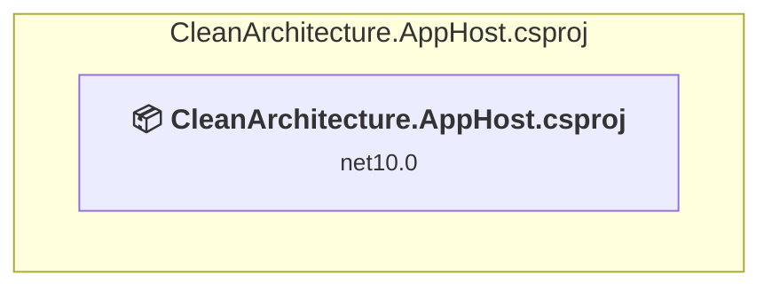

# CleanArchitecture.AppHost\CleanArchitecture.AppHost.csproj

[← Back to the assessment index](../../assessment.md)

## Project Info

- **Current Target Framework:** net10.0
- **Proposed Target Framework:** net11.0
- **SDK-style**: True
- **Project Kind:** DotNetCoreApp
- **Dependencies**: 0
- **Dependants**: 0
- **Number of Files**: 1
- **Number of Files with Incidents**: 1
- **Lines of Code**: 25
- **Estimated LOC to modify**: 0+ (at least 0,0% of the project)

## Dependency Graph

Legend:
📦 SDK-style project
⚙️ Classic project

## API Compatibility

| Category | Count | Impact |
| :--- | :---: | :--- |
| 🔴 Binary Incompatible | 0 | High - Require code changes |
| 🟡 Source Incompatible | 0 | Medium - Needs re-compilation and potential conflicting API error fixing |
| 🔵 Behavioral change | 0 | Low - Behavioral changes that may require testing at runtime |
| ✅ Compatible | 14 |  |
| ***Total APIs Analyzed*** | ***14*** |  |

## NuGet Package Issues

| Package | Current Version | Suggested Version | Severity | Issue |
| :--- | :---: | :---: | :---: | :--- |
| Aspire.Hosting.AppHost | 13.6.0 | 13.6.4 | 🟡 Potential | La mise à niveau du package NuGet est recommandée |
| Aspire.Hosting.Orchestration.win-x64 | 13.6.0 | 13.6.4 | 🟡 Potential | La mise à niveau du package NuGet est recommandée |
| Aspire.Hosting.RabbitMQ | 13.6.0 | 13.6.4 | 🟡 Potential | La mise à niveau du package NuGet est recommandée |
| Aspire.Hosting.Redis | 13.6.0 | 13.6.4 | 🟡 Potential | La mise à niveau du package NuGet est recommandée |
| Aspire.Hosting.SqlServer | 13.6.0 | 13.6.4 | 🟡 Potential | La mise à niveau du package NuGet est recommandée |

Every project affected by these packages, and the versions the repository settles on: [aggregate NuGet packages](../nuget/aggregate-packages.md).

