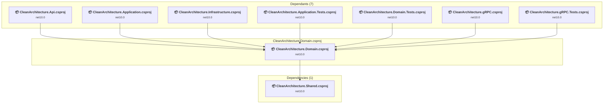

# CleanArchitecture.Domain\CleanArchitecture.Domain.csproj

[← Back to the assessment index](../../assessment.md)

## Project Info

- **Current Target Framework:** net10.0
- **Proposed Target Framework:** net11.0
- **SDK-style**: True
- **Project Kind:** ClassLibrary
- **Dependencies**: 1
- **Dependants**: 7
- **Number of Files**: 59
- **Number of Files with Incidents**: 1
- **Lines of Code**: 2206
- **Estimated LOC to modify**: 0+ (at least 0,0% of the project)

## Related Projects

**Depends on (1)** — projects this one references:

- [C:\Users\pierr\projets\CleanArchitecture-upgrade-agent\CleanArchitecture.Shared\CleanArchitecture.Shared.csproj](../projects/CleanArchitecture.Shared.md)

**Depended on by (7)** — projects that reference this one:

- [C:\Users\pierr\projets\CleanArchitecture-upgrade-agent\CleanArchitecture.Api\CleanArchitecture.Api.csproj](../projects/CleanArchitecture.Api.md)
- [C:\Users\pierr\projets\CleanArchitecture-upgrade-agent\CleanArchitecture.Application.Tests\CleanArchitecture.Application.Tests.csproj](../projects/CleanArchitecture.Application.Tests.md)
- [C:\Users\pierr\projets\CleanArchitecture-upgrade-agent\CleanArchitecture.Application\CleanArchitecture.Application.csproj](../projects/CleanArchitecture.Application.md)
- [C:\Users\pierr\projets\CleanArchitecture-upgrade-agent\CleanArchitecture.Domain.Tests\CleanArchitecture.Domain.Tests.csproj](../projects/CleanArchitecture.Domain.Tests.md)
- [C:\Users\pierr\projets\CleanArchitecture-upgrade-agent\CleanArchitecture.gRPC.Tests\CleanArchitecture.gRPC.Tests.csproj](../projects/CleanArchitecture.gRPC.Tests.md)
- [C:\Users\pierr\projets\CleanArchitecture-upgrade-agent\CleanArchitecture.gRPC\CleanArchitecture.gRPC.csproj](../projects/CleanArchitecture.gRPC.md)
- [C:\Users\pierr\projets\CleanArchitecture-upgrade-agent\CleanArchitecture.Infrastructure\CleanArchitecture.Infrastructure.csproj](../projects/CleanArchitecture.Infrastructure.md)

## Dependency Graph

Legend:
📦 SDK-style project
⚙️ Classic project

## API Compatibility

| Category | Count | Impact |
| :--- | :---: | :--- |
| 🔴 Binary Incompatible | 0 | High - Require code changes |
| 🟡 Source Incompatible | 0 | Medium - Needs re-compilation and potential conflicting API error fixing |
| 🔵 Behavioral change | 0 | Low - Behavioral changes that may require testing at runtime |
| ✅ Compatible | 1371 |  |
| ***Total APIs Analyzed*** | ***1371*** |  |

