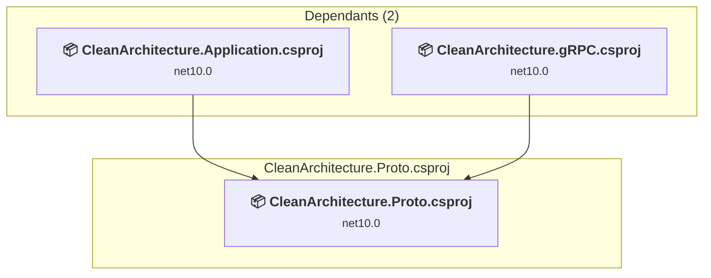

# CleanArchitecture.Proto\CleanArchitecture.Proto.csproj

[← Back to the assessment index](../../assessment.md)

## Project Info

- **Current Target Framework:** net10.0
- **Proposed Target Framework:** net11.0
- **SDK-style**: True
- **Project Kind:** ClassLibrary
- **Dependencies**: 0
- **Dependants**: 2
- **Number of Files**: 0
- **Number of Files with Incidents**: 3
- **Lines of Code**: 0
- **Estimated LOC to modify**: 4+ (at least 0,0% of the project)

## Related Projects

**Depended on by (2)** — projects that reference this one:

- [C:\Users\pierr\projets\CleanArchitecture-upgrade-agent\CleanArchitecture.Application\CleanArchitecture.Application.csproj](../projects/CleanArchitecture.Application.md)
- [C:\Users\pierr\projets\CleanArchitecture-upgrade-agent\CleanArchitecture.gRPC\CleanArchitecture.gRPC.csproj](../projects/CleanArchitecture.gRPC.md)

## Dependency Graph

Legend:
📦 SDK-style project
⚙️ Classic project

## API Compatibility

| Category | Count | Impact |
| :--- | :---: | :--- |
| 🔴 Binary Incompatible | 0 | High - Require code changes |
| 🟡 Source Incompatible | 4 | Medium - Needs re-compilation and potential conflicting API error fixing |
| 🔵 Behavioral change | 0 | Low - Behavioral changes that may require testing at runtime |
| ✅ Compatible | 488 |  |
| ***Total APIs Analyzed*** | ***492*** |  |

