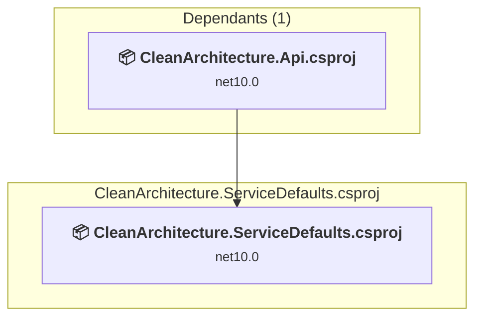

# CleanArchitecture.ServiceDefaults\CleanArchitecture.ServiceDefaults.csproj

[← Back to the assessment index](../../assessment.md)

## Project Info

- **Current Target Framework:** net10.0
- **Proposed Target Framework:** net11.0
- **SDK-style**: True
- **Project Kind:** ClassLibrary
- **Dependencies**: 0
- **Dependants**: 1
- **Number of Files**: 2
- **Number of Files with Incidents**: 2
- **Lines of Code**: 211
- **Estimated LOC to modify**: 1+ (at least 0,5% of the project)

## Related Projects

**Depended on by (1)** — projects that reference this one:

- [C:\Users\pierr\projets\CleanArchitecture-upgrade-agent\CleanArchitecture.Api\CleanArchitecture.Api.csproj](../projects/CleanArchitecture.Api.md)

## Dependency Graph

Legend:
📦 SDK-style project
⚙️ Classic project

## API Compatibility

| Category | Count | Impact |
| :--- | :---: | :--- |
| 🔴 Binary Incompatible | 1 | High - Require code changes |
| 🟡 Source Incompatible | 0 | Medium - Needs re-compilation and potential conflicting API error fixing |
| 🔵 Behavioral change | 0 | Low - Behavioral changes that may require testing at runtime |
| ✅ Compatible | 94 |  |
| ***Total APIs Analyzed*** | ***95*** |  |

## NuGet Package Issues

| Package | Current Version | Suggested Version | Severity | Issue |
| :--- | :---: | :---: | :---: | :--- |
| Microsoft.Extensions.Http.Resilience | 10.10.0 | 10.11.0 | 🟡 Potential | La mise à niveau du package NuGet est recommandée |
| Microsoft.Extensions.ServiceDiscovery | 10.10.0 | 10.11.0 | 🟡 Potential | La mise à niveau du package NuGet est recommandée |
| OpenTelemetry.Instrumentation.AspNetCore | 1.19.0 | 1.20.1 | 🟡 Potential | La mise à niveau du package NuGet est recommandée |
| OpenTelemetry.Instrumentation.Http | 1.19.0 | 1.20.1 | 🟡 Potential | La mise à niveau du package NuGet est recommandée |

Every project affected by these packages, and the versions the repository settles on: [aggregate NuGet packages](../nuget/aggregate-packages.md).

